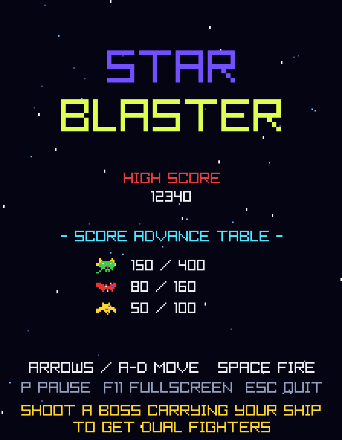
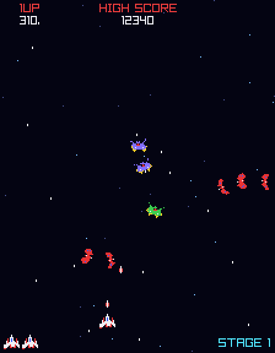
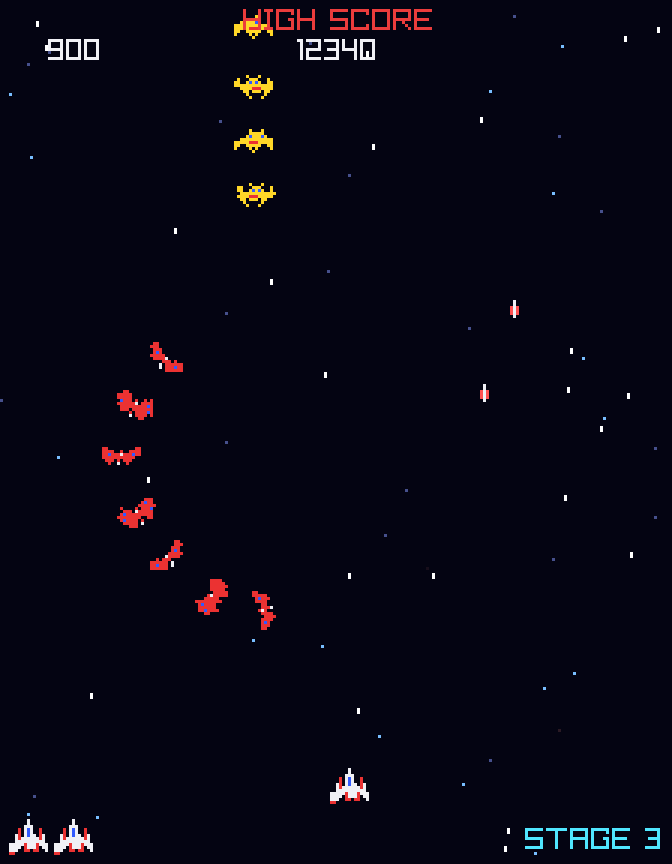

<div align="center">



# S T A R &nbsp; B L A S T E R

**A Galaga-style arcade space shooter in C# and .NET 10.**
Classic 224×288 arcade resolution · every sprite and sound generated in code · zero asset files.

[](https://github.com/FilipStruhar/StarBlaster/actions/workflows/ci.yml)
[](https://dotnet.microsoft.com/download)
[](https://github.com/raylib-cs/raylib-cs)
[](LICENSE)




</div>

---

## Features

- **Authentic arcade feel**: 40 enemies swoop in along curved paths, settle into a swaying, "breathing" formation, then dive-bomb you.
- **Tractor beam & dual fighter**: get captured, shoot the boss to rescue your ship, and fly with double width and double fire.
- **Challenging stages**: every 4th stage is a no-shooting-back bonus round with a 10,000-point perfect bonus.
- **100% procedural assets**: sprites and sound effects are generated at startup. The repo has no images or audio files in the game itself.
- **Crisp pixel scaling**: renders at the native 224×288 and scales by whole-number factors, with optional CRT scanlines.
- **Gamepad support**: plug in a controller and play.
- **Deterministic & tested**: seeded runs and a headless self-test suite (rule checks plus a bot that plays the game).

## Quick start

You need the [.NET 10 SDK](https://dotnet.microsoft.com/download). Raylib's native libraries ship with the NuGet package, so there is nothing else to install.

```sh
git clone https://github.com/FilipStruhar/StarBlaster.git
cd StarBlaster
dotnet run -c Release
```

## Controls

| Key | Action |
|---|---|
| <kbd>←</kbd> <kbd>→</kbd> / <kbd>A</kbd> <kbd>D</kbd> | Move (gamepad stick / d-pad also works) |
| <kbd>Space</kbd> / <kbd>Z</kbd> / <kbd>Ctrl</kbd> | Fire |
| <kbd>Enter</kbd> / <kbd>Space</kbd> | Start |
| <kbd>P</kbd> | Pause |
| <kbd>F11</kbd> | Borderless fullscreen |
| <kbd>F1</kbd> | Toggle scanlines |
| <kbd>Esc</kbd> | Back to title / quit |

## How to play

<div align="center">

</div>

### Score advance table

| Enemy | Formation | Diving | Notes |
|---|---:|---:|---|
| Bee | 50 | 100 | |
| Butterfly | 80 | 160 | |
| Boss | 150 | 400 | Takes two hits |

- A boss may open a **tractor beam** and capture your ship. Shoot that boss **while it dives** to free the prisoner and get a **dual fighter**. Kill it in formation and the prisoner is lost.
- Every 4th stage (3, 7, 11 …) is a **challenging stage**: enemies don't shoot back, each hit is worth 100, and a perfect 40/40 is worth **10,000**.
- Extra ships are awarded at **20,000** points and every **70,000** after that.
- Your high score is saved between sessions in your local application-data folder.

## Developer tools

The executable doubles as a small dev toolkit:

```sh
dotnet run -- --selftest                                  # headless rule checks, non-zero exit on failure
dotnet run -- --shot out.png --frames 600 --seed 3 --god  # bot-driven screenshot
dotnet run -- --shot title.png --title                    # title-screen screenshot
```

| Flag | Meaning |
|---|---|
| `--selftest` | Run the headless scenario suite (capture, rescue, challenge stage, autoplay) |
| `--shot <file>` | Let the built-in bot play, then save a frame as PNG |
| `--frames <n>` | Number of simulated frames before the shot (default 600) |
| `--seed <n>` | RNG seed, making runs reproducible (default 1) |
| `--stage <n>` | Start from the given stage (default 1) |
| `--god` | Invincible player |
| `--title` | Capture the title screen instead of gameplay |

The screenshots and GIF in this README were produced with these flags (then upscaled with nearest-neighbour filtering).

## Project structure

```text
StarBlaster/
├── Program.cs          Entry point, input mapping, window loop, dev CLI
├── Game/               Pure game logic: no rendering, no audio, no Raylib
│   ├── Game.cs           Phases, waves, scoring, capture/rescue rules
│   ├── Entities.cs       Enums and data types: enemies, shots, particles, input
│   ├── PathCurve.cs      Curved flight paths
│   └── Bot.cs            Autoplay AI used by tests and screenshots
├── Platform/           Raylib-backed presentation
│   ├── Renderer.cs       Low-res render target, scaling, scanlines
│   ├── Sprites.cs        Generated pixel sprites
│   └── SoundBank.cs      Synthesized sound effects
└── Tests/
    └── SelfTest.cs     Headless scenario checks (--selftest)
```

Because `Game/` never touches Raylib, the entire ruleset can be simulated headlessly. That is what makes the self-test and the screenshot tooling possible.

## Contributing

Pull requests are welcome. Please read [CONTRIBUTING.md](CONTRIBUTING.md) first, and make sure `dotnet run -- --selftest` passes.

## Acknowledgments

- [raylib](https://www.raylib.com/) and [Raylib-cs](https://github.com/raylib-cs/raylib-cs) (zlib license) for windowing, input and rendering.
- *Galaga* (Namco, 1981) for the gameplay that inspired this project.

## License

Released under the [MIT License](LICENSE).

> Star Blaster is an independent fan project inspired by classic arcade shooters. It is not affiliated with or endorsed by Bandai Namco. All sprites and sounds are original and generated in code.
